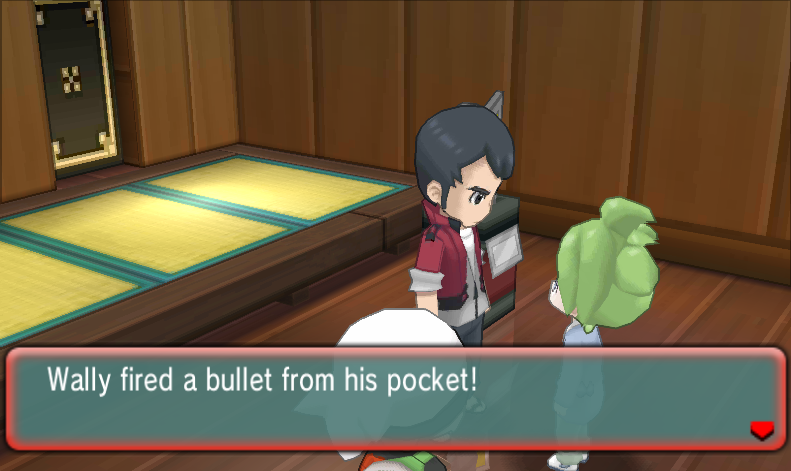
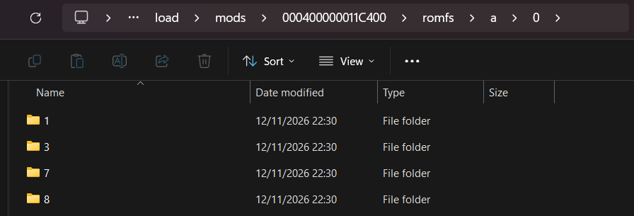
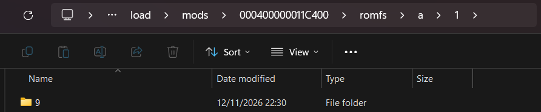
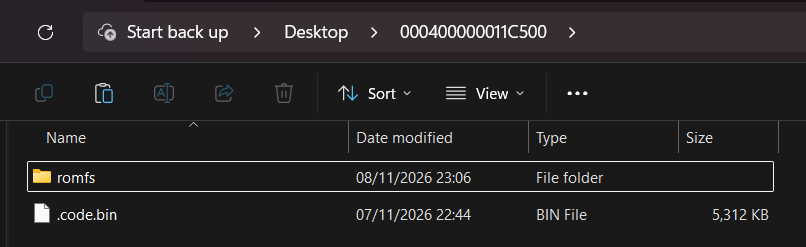

# ORAS-TR: Pokémon Omega Ruby / Alpha Sapphire Translator

**ORAS-TR** is an automated Python tool designed to translate text files extracted from Pokémon Omega Ruby and Alpha Sapphire (ORAS) using the local translation model NLLB.

This script runs the game’s text through multiple levels of translation between various languages, creating what some people would know as… absolute chaos.

 

## Features

* **Local AI Translation:** Translates text entirely offline using your local hardware.

* **Control Code Protection:** Safely isolates and protects game variables, line breaks (`\n`, `\c`), and gender symbols (`♂`, `♀`) so the AI doesn't translate them into garbage text.

* **Infinite Loop Capping:** Dynamically caps translation outputs based on the original English text length to prevent massive infinite-loop strings from crashing the 3DS or emulator.

* **Automated Sanitization:** Cleans up orphaned or broken backslashes (e.g., `\ `) that abort the `pk3DS` import process.

## Prerequisites

1. ~~**Python 3.8+** installed on your system. If you do not have Python already, 3.12 is recommended (DirectML requires Python 3.12).~~ *Python should now automatically be installed for the project since v0.0.2.*

2. [pk3DS](https://projectpokemon.org/home/forums/topic/34377-pk3ds-pok%C3%A9mon-3ds-rom-editor-and-randomizer/) (for dumping and re-importing the game text).

3. A dump of Pokémon Omega Ruby or Alpha Sapphire (I personally recommend [this guide](https://3ds.hacks.guide/dumping-titles-and-game-cartridges.html) from the 3ds.hacks.guide team).

4. [HackingToolKit9DS](https://github.com/Asia81/HackingToolkit9DS/releases), or any program that can be used to extract the romfs folder from the game.

## Installation

1. Download the [latest release](https://github.com/Eviolites/ORAS-TR/releases/) of ORAS-TR.
2. Unzip the folder and run ORAS-TR.bat. 

## How to use

## NOTE: In my experience on an AMD 9070 XT and a 3070 Ti, translation can take up to 2 hours, potentially more on older hardware.

**Step 0: Dump the `romfs` folder**
 
 (This can be skipped if you use the files in the `source` folder instead of providing your own)

__With HackingToolKit9DS (game dumps in .cia or .3ds format)__

1. Run SetupUS.exe within HackingToolKit9DS/PackHack in order to install required dependencies.

2. Run HackingToolKit9DS in the same folder, and drag/copy/paste your .cia or .3ds file of your game to this folder.

3. When the command prompt shows, type `D` if you are using a .3ds file, or `CE` if you are using a .cia file. Follow the instructions on the command prompt further.

Once this is completed, you should have a romfs folder that you can use in PK3DS. Just use `File -> Open` and select the PackHack folder, or whichever folder is before your romfs folder.

__With GodMode9 (cartridge game, requires a modded 3DS)__

1. With your cartridge game inserted into your console, hold `START` whilst powering on the console to access GodMode9.

2. Enter `[C:] GAMECART ()` and click on the `<game>.trim.3ds` file.

3. Press `NCSD image options...`, then select `Mount image to drive`. Then, press A to open the drive.

4. Open the `content0.game` folder and your romfs folder should be there.

You can then press `R`+`A` whilst hovering over the folder to copy it to gm9/out on your SD card and transfer it however you prefer.

**Step 1: Dump the Text** 

(This can be skipped if you use the files in the `source` folder instead of providing your own. Providing your own files could be useful in situations where you want to test the program on other Pokémon games, but **PLEASE** bear in mind that only the ORAS games have been tested here.)

1. Open the folder containing your ORAS romfs folder in **pk3DS**.

2. Navigate to the `Text` section.

3. Export the text you want to translate (e.g., Story Text, Game Text) to a `.txt` file.

**Step 2: Translate**

1. Place the dumped `.txt` file(s) into one directory, as the tool can only take one input for the folder location.

2. Double-click **`ORAS-TR.bat`**. The script will then run the entire script through multiple levels of translation, and output them as `gametext.txt/storytext.txt` depending on the contents of the file.
   The script asks how many intermediate languages to use. The selected number is saved in the translation checkpoint so if there are any interruptions, the script can resume from where it was.

**Step 3: Re-Import**

Note: if you want to keep your romfs and exefs dumps intact, copy them to another location as this **WILL** edit the existing dumps!!

1. Open **pk3DS**.

2. Navigate to the `Text` section and click **Import**.

3. Select your newly translated `.txt` file.

**Step 4: Patch existing game**

__Title ID folder (requires Luma3DS Game Patching enabled)__

1. Create a new folder with the Title ID of your game.
   - `000400000011C400` for **Omega Ruby** or `000400000011C500`for **Alpha Sapphire**. These are not region specific and will work on any game region.

2. Copy the newly edited `romfs` folder into the Title ID folder.

3. Delete everything in the `romfs` folder except for `a/0/7` and `a/0/8` (these are the text files).
   - *If you randomised wild encounters, starter Pokémon etc. whilst using PK3DS, keeping the files listed below will reduce size and still enable randomisation:*
     
     

4. *(optional, this is mainly when changes to the Move Tutor or TMs have been made)* Enter the `exefs` folder, copy `.code.bin`, and move it to the Title ID folder.
   - Your Title ID folder should now look something like this:

__If you are using Luma3DS (3DS console with CFW installed)__

1. Copy the Title ID folder that you have just created to `luma/titles` on your 3DS' SD card (using an FTP software such as FTPD works too).

2. Ensure that 'Enable game patching' is enabled in your [Luma3DS config menu](https://3ds.hacks.guide/checking-for-cfw.html).

3. Load your game and the mod should automatically apply!

__If you are using an emulator (e.g. Azahar, Citra)__

1. Open your emulator, right click on your installed game, then press `Open -> Mods Location`

2. Paste **ONLY** your `romfs` folder and `.code.bin` file here. The emulator automatically detects the Title ID for you.

3. Load your game and the mod should automatically apply!

## Troubleshooting & Known Issues

* Sometimes, prompts can come up blank, such as the 'Yes' button. Although safeguards have been put in place to try and prevent this, it is still an issue that is being currently worked on.

## License

This project is open-source. Please feel free to fork, modify, and improve the script! 

## AI Declaration

AI (specifically CoPilot and Gemini) was used to assist with the creation of this project. CoPilot was primarily used in the creation of the .bat file whilst Gemini assisted with troubleshooting issues throughout the project. All code has been thoroughly tested on ROCm (9070 XT) and CUDA (3070 Ti) machines, alongside multithreading using CPU (Ryzen 7 7800x3D). All code has been verified and checked by myself, but if there are any concerns or improvements please feel free to make a PR or raise an issue and I will be happy to have a look!
