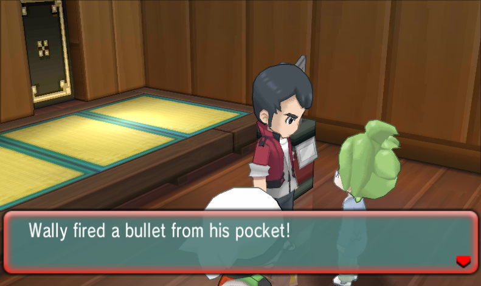

# ORAS-TR: Pokémon Omega Ruby / Alpha Sapphire Translator

**ORAS-TR** is an automated Python tool designed to translate text files extracted from Pokémon Omega Ruby and Alpha Sapphire (ORAS) using the local translation model basis of NLLB.

This script runs the game’s text through multiple levels of translation between various languages, creating what some people would know as… absolute chaos.

 

## ✨ Features

* **Local AI Translation:** Translates text entirely offline using your local hardware.

* **Control Code Protection:** Safely isolates and protects game variables, line breaks (`\n`, `\c`), and gender symbols (`♂`, `♀`) so the AI doesn't translate them into garbage text.

* **Infinite Loop Capping:** Dynamically caps translation outputs based on the original English text length to prevent massive infinite-loop strings from crashing the 3DS or emulator.

* **Automated Sanitization:** Cleans up orphaned or broken backslashes (e.g., `\ `) that abort the `pk3DS` import process.

## 📁 Repository Contents

* `ORAS-TR.py` - The main Python translation script.

* `ORAS-TR.bat` - A quick-launch batch file for Windows users to easily execute the script.

* `ORAS-TR.sh` - A quick-launch script for macOS users, including Apple Silicon MPS support.

* `ORAS-TR.command` - A macOS double-click launcher for the shell script.

* `install_requirements.py` - Setup script to automatically install the required dependencies.

* `requirements.txt` - Python package dependencies list.
  

## 🛠️ Prerequisites

1. **Python 3.8+** installed on your system. If you do not have Python already, 3.13 is recommended.

2. [pk3DS](https://projectpokemon.org/home/forums/topic/34377-pk3ds-pok%C3%A9mon-3ds-rom-editor-and-randomizer/) (for dumping and re-importing the game text).

3. A dump of Pokémon Omega Ruby or Alpha Sapphire (I personally recommend [this guide](https://3ds.hacks.guide/dumping-titles-and-game-cartridges.html) from the 3ds.hacks.guide team).

4. [HackingToolKit9DS](https://github.com/Asia81/HackingToolkit9DS/releases) or any program that can be used to extract the romfs folder from the game.

## 🚀 Installation

1. Download the [latest release](https://github.com/Eviolites/ORAS-TR/releases/tag/alpha) of ORAS-TR.
2. Unzip the folder and run `ORAS-TR.bat` on Windows or double-click
`ORAS-TR.command` on macOS. From Terminal, you can also run `./ORAS-TR.sh`.

On Apple Silicon Macs, the installer automatically selects PyTorch's `mps` backend. You can also select it explicitly with `./ORAS-TR.sh mps`.

## 🎮 Usage

## NOTE: In my experience on an AMD 9070 XT and a 3070 Ti, translation can take up to 2 hours, potentially more on older hardware.

**Step 0: Dump the romfs folder**

__With HackingToolKit9DS (game dumps in .cia or .3ds format)__

1. Run SetupUS.exe within HackingToolKit9DS/PackHack in order to install required dependencies.

2. Run HackingToolKit9DS in the same folder, and drag/copy/paste your .cia or .3ds file of your game to this folder.

3. When the command prompt shows, type `D` if you are using a .3ds file, or `CE` if you are using a .cia file. Follow the instructions on the command prompt further.

Once this is completed, you should have a romfs folder that you can use in PK3DS. Just use `File -> Open` and select the PackHack folder, or whichever folder is before your romfs folder.

__With GodMode9 (cartridge game, requires a modded 3DS)__

1. With your cartridge game inserted into your console, hold `START` whilst powering on the console to access GodMode9.

2. Enter `[C:] GAMECART ()` and click on the `<game>.trim.3ds` file.

3. Press `NCSD image options...`, then select `Mount image to drive`. Then, press A to open the drive.

4. Open the `content0.game` folder and your romfs folder should be there.

You can then press `R`+`A` whilst hovering over the folder to copy it to gm9/out on your SD card and transfer it however you prefer.

**Step 1: Dump the Text**

1. Open the folder containing your ORAS romfs folder in **pk3DS**.

2. Navigate to the `Text` section.

3. Export the text you want to translate (e.g., Story Text, Game Text) to a `.txt` file.

**Step 2: Translate**

1. Place the dumped `.txt` file(s) into one directory, as the tool can only take one input.

2. Double-click **`ORAS-TR.bat`**. The script will then run the entire script through multiple levels of translation, and output them as `gametext.txt/storytext.txt` depending on the contents of the file.

**Step 3: Re-Import**

1. Open **pk3DS** again.

2. Navigate to the `Text` section and click **Import**.

3. Select your newly translated `.txt` file.

4. Rebuild your RomFS and test it in your emulator!

## ⚠️ Troubleshooting & Known Issues

Because AI translation models can be unpredictable, you may occasionally run into import errors in pk3DS, even with fail-safe methods in place. If `pk3DS` throws an error or aborts the import, use the following Regex searches in VS Code or Notepad++ on your translated `.txt` file to fix the remaining artifacts:

* **Crashing on Import (Broken Variables):** The model may have translated a system variable (e.g., turning `[VAR TRNAME(0000)]` into `[VAR Name(0000)]`). Search for `\[VAR [a-z]` (Regex enabled) to find any variables containing lowercase letters and replace them with the original English bracket.

* **Crashing on Import (Infinite Loops):** If the model panicked and generated an infinite loop of text, it will exceed the memory buffer and crash the game. Search for `^.{150,}$` (Regex enabled) to find lines exceeding 150 characters. Delete the repeated text or revert it to the original English.

* **Stray Backslashes:** Ensure there are no backslashes followed by a space (`\ `). Search for `\\(?![a-zA-Z])` and replace with nothing to clean them up.

## 📝 License

This project is open-source. Please feel free to fork, modify, and improve the script!

## 🤖 AI Declaration

AI (specifically CoPilot and Gemini) was used to assist with the creation of this project. CoPilot was primarily used in the creation of the .bat file whilst Gemini assisted with troubleshooting issues throughout the project. All code has been thoroughly tested on ROCm (9070 XT) and CUDA (3070 Ti) machines, alongside multithreading using CPU (Ryzen 7 7800x3D). All code has been verified and checked by myself, but if there are any concerns or improvements please feel free to make a PR or raise an issue and I will be happy to have a look!
